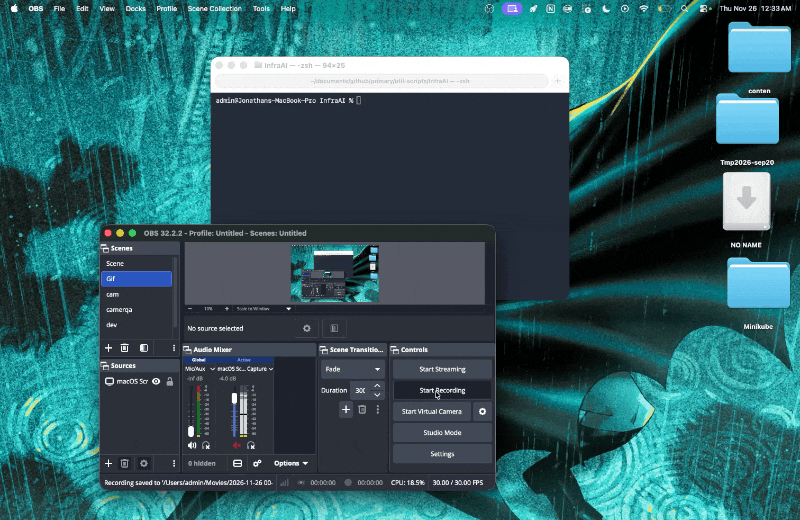

# InfraAI

Golang Script that allows you to communicate with self hosted AI models via Ollama API

## How to use

- run `go run script.go` to configure + run chat

## How it works
- `script.go`
    - Configure connection + cache endpoint for later usage
    - Verify Connection is valid
    - Run a CLI based communication between user and self hosted model

